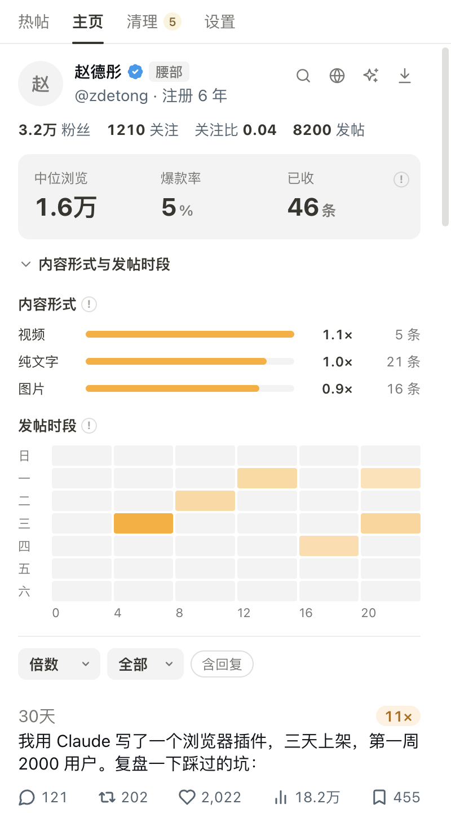

<p align="center">
  
</p>

<h1 align="center">福滤娃 FeedSieve</h1>

<p align="center">
  <strong>用了福滤娃，评论区不骚了，好帖也不漏了。</strong><br>
  开源的中文 X（Twitter）副驾驶：清评论、看热帖、挖博主、排发帖、辨 AI 味——一个装全，本地优先，不拿账号冒险。
</p>

<p align="center">
  <a href="https://chromewebstore.google.com/detail/feedsieve/amhdjglnonjaoenddnifpnljgmocfdph"></a>
  <a href="https://addons.mozilla.org/zh-CN/firefox/addon/feedsieve-fuluwa/"></a>
  <a href="https://chromewebstore.google.com/detail/feedsieve/amhdjglnonjaoenddnifpnljgmocfdph"></a>
  <a href="https://github.com/realchendahuang/feedsieve/stargazers"></a>
  <a href="https://github.com/realchendahuang/feedsieve/releases"></a>
  <a href="LICENSE"></a>
  <a href="https://github.com/realchendahuang/feedsieve/commits/main"></a>
  <a href="CONTRIBUTING.md"></a>
</p>

<p align="center">
  <a href="https://chromewebstore.google.com/detail/feedsieve/amhdjglnonjaoenddnifpnljgmocfdph"><strong>⬇️ Chrome 商店一键安装</strong></a>
  ·
  <a href="https://addons.mozilla.org/zh-CN/firefox/addon/feedsieve-fuluwa/"><strong>🦊 Firefox 商店一键安装</strong></a>
  ·
  <a href="https://feedsieve.win"><strong>🌐 官网与公示</strong></a>
  ·
  <a href="https://feedsieve.win/guide">使用教程</a>
  ·
  <a href="https://feedsieve.win/lists/blacklist">黑名单公示</a>
  ·
  <a href="https://feedsieve.win/lists/keywords">开源词库</a>
  ·
  <a href="CHANGELOG.md">更新日志</a>
</p>

---

## 它能做什么

|            | 清干净                                          | 看得准                                                                                   | 挖得深                                                             | 发得顺                                                                    | 辨得清                                                         |
| ---------- | ----------------------------------------------- | ---------------------------------------------------------------------------------------- | ------------------------------------------------------------------ | ------------------------------------------------------------------------- | -------------------------------------------------------------- |
| **解决**   | 评论区的黄推、引流号、水军                      | 刷了一晚上，不知道哪条正在火                                                             | 想研究一个博主，X 只给你按时间排的帖子                             | 手动卡点发帖、Markdown 排版来回折腾                                       | 分不清对面是真人还是 AI 复读机                                 |
| **做法**   | 黄框标出写明理由，点一下走 X 原生拉黑，全端同步 | 每条帖子显示每小时浏览数和作者量级；「热帖」汇总你刷到的火帖，「全站」汇总所有用户刷到的 | 打开任意博主主页：每条帖子是他中位数的几倍，哪种形式、哪个时段最好 | 发帖节奏 + 每小时容量 + 草稿队列；文章编辑器直接粘 Markdown、自动本机备份 | 读最近回复给 AI 味百分比；多人重合才公开，够票进社区 AI 号名单 |
| **在哪看** | 时间线上、弹窗「清理」                          | 推文右上角、弹窗 / 侧边栏「热帖」                                                        | 博主资料卡下、侧边栏「主页」                                       | 弹窗 / 侧边栏「发帖」、X 发帖框与文章编辑器                               | 评论区机器人图标、主页「AI 味」Tab、弹窗「AI 味」              |

除了你主动点的「AI 味」检测和「补全这个博主」会往下滚动，扩展**不替你滚动页面、不额外请求 X、不上传你的登录凭证**，详见下文「[数据从哪来](#数据从哪来)」。

---

## 清干净：只框不藏，拉黑交给你

中文 X 的评论区，黄推复读机、币圈引流怪、洗稿僵尸号比真人还勤快。常见的自救工具走两个极端：本地隐藏只骗得了这一个浏览器，手机上照样骑脸；黑盒拉黑脚本规则不公开、误杀没人知道，还会因为狂刷接口把你自己的号送进风控。

福滤娃的做法：

- **只框不藏**：命中的账号打黄框，写明理由（`命中黑名单: 3人标记`、`全角变形: 那一夜你没有拒绝我`），推文原样保留，要不要送走由你决定。
- **原生拉黑**：用你已登录的 X 会话调用原生 Block，手机、平板、电脑同步生效，对方再也不能回复、@、私信你。
- **不连累你的号**：批量拉黑每 24 小时最多 400 个，带随机间隔；X 一返回 429 就停下休眠。
- **误伤能救**：关注的人自动保护；拉错了在「已拉黑」里一键放回；社区抢救票能让误标账号全网解封。
- **规则公开**：[社区黑名单](https://feedsieve.win/lists/blacklist)、[开源词库](https://feedsieve.win/lists/keywords)、[推荐白名单](https://feedsieve.win/lists/whitelist)全部公示；名单快照带 Ed25519 签名，本地验签后才生效。

|              | 本地隐藏       | 黑盒拉黑脚本       | **福滤娃**                          |
| ------------ | -------------- | ------------------ | ----------------------------------- |
| 生效范围     | 只有这个浏览器 | 全端               | **全端**                            |
| 你看得到什么 | 内容直接消失   | 后台静默拉黑       | **黄框 + 理由，内容原样**           |
| 谁来决定     | 插件           | 插件               | **你点了才拉黑**                    |
| 误伤         | 不知道         | 申诉无门           | **一键放回 + 社区抢救**             |
| 账号安全     | 不调接口       | 并发狂刷，容易 429 | **400 个/天 + 随机间隔 + 限流熔断** |

---

## 看得准：哪条正在火，一眼可见

- **流速**：推文右上角显示当前每小时浏览数，`1K/h` 以上变红，`10K/h` 以上实心红。算法和 X 推荐系统的浏览衰减模型一致，见 [docs/03](docs/03-X推荐算法与指标设计.md)。
- **量级**：作者名旁显示微光 / 新芽 / 新锐 / 星火 / 人气 / 达人 / 知名 / 影响力 / 头部 / 顶流和粉丝数；悬停看关注比、注册时间、疑似互关号等提示。
- **热帖**：弹窗或侧边栏里汇总你最近 2 小时在所有 X 标签页刷到的火帖。
  - 可按热度、回复机会、粉丝数、收藏数、最近刷到排序。
  - 没在看的时候新帖直接插到顶部，正在看的时候只出提示条，列表不会在你手底下跳。
  - 可以隐藏单条帖子或某个作者，同一作者的多条自动合并，支持 j / k 键盘操作。
- **全站热榜**：汇总所有福滤娃用户刷到的火帖，至少 3 个人看到才上榜。只上报正在火的公开帖子指标，不带你的账号，可在设置里关闭。

---

## 挖得深：打开任意博主主页

<p align="center">
  
</p>

X 的主页只按时间排帖子，想找一个博主最好的那几条，只能一直往下翻。福滤娃在博主资料卡下加一行概况，侧边栏「主页」给出完整分析：

- **爆款倍数**：每条帖子的浏览 ÷ 他自己帖子浏览的中位数。用中位数不用平均数，一两条大爆款不会把基线拉偏；3 倍以上标金色。博主主页上，主人自己的帖子右上角也会直接显示倍数。
- **爆款率与基线**：只算原创和引用、发出满 24 小时的帖子；刚发的帖子按预计 24 小时浏览估算，标 `~`。
- **规律**：纯文字 / 图片 / 视频 / 引用各自的中位倍数；7 天 × 6 个时段的发帖热力图。
- **补数据**：一键在 X 搜他的高赞帖（`from:他 min_faves:N`，N 按他的中位点赞自动选）；或者用 Google 站内搜索他的帖子，按关键词和时间范围找。
- **带走**：复制 Top 20 爆款给 AI 分析钩子和结构；导出 CSV。

---

## 发得顺：排期、草稿、文章，都在 X 里完成

不发帖的人用不上，天天发的人省半小时。所有填写都发生在 X 自己的发帖框和文章编辑器里，**最后一下永远由你点**。

- **发帖节奏**：先设集中时段（可以多段，比如工作日早上 + 晚上）、每小时最多几条；分钟在小时内随机，分配后固定。可选星期、最小间隔、最早提前量和最多提前几天。设置页直接显示「本周最多 N 条」，能按你自己主页的「发帖时段表现」一键推荐 3 个时段。
- **排下一条**：发帖框日历旁加一个按钮（快捷键 `Alt+N`），自动找下一个还有名额的小时，填好随机分钟；X 安排表顶部还有 +1 小时、+3 小时、明天此时、同上一条、±15 分钟，选得太近或已经过了会提示。
- **草稿队列**：在面板里先写好几条（按 X 规则计字，超 280 标黄），可上下排序；点日历按钮把正文贴进当前 X 页面的发帖框、填好时间，你检查后点 X 的「确认」「预排期」。排好后同样正文的草稿自动拿掉；发帖框里有没写完的内容时不动它。
- **容量一眼看清**：面板按天列出已排期的帖子、待确认的排期，以及本周每个小时的「已排 / 上限」；点一个还有空位的小时，会把队列里的下一条排进去。数据读 X 自己的「草稿 › 预排期」页，你在 X 里新建、修改、删除也会自动更新。
- **Markdown 直接粘**：在 X 文章编辑器里粘贴 Markdown 自动排版——标题、列表、任务列表、引用、加粗 / 斜体 / 删除线、链接保留，代码块变引用并保留缩进，表格逐行展开；开头的 `# 标题` 或 frontmatter 的 `title` 自动填进文章标题。`⌘Z` 可撤销，`⌘⇧V` 粘贴原文。
- **写作小面板**：正文字数 / 英文词数、预计阅读时长、小标题大纲（点击跳转）；可导入 `.md` 文件接在正文末尾；右下角一键「复制为 Markdown」。
- **本机备份**：写作时标题和正文按 Markdown 存在本机，每篇留 5 个版本（10 分钟内的修改合并成一版），最多 30 篇；在「发帖 › 文章备份」里选版本复制回去，或回到 X 打开那篇。

发帖节奏、草稿、本机占好的排期、读到的预排期和文章备份都只存本机（`storage.local`），不上传，也不为此额外请求 X。

---

## 辨得清：这条回复是不是 AI 写的

中文 X 的评论区正在被 AI 复读机占领：语气客气、结构工整、说了一屏等于没说。福滤娃给账号算一个「AI 味」，但**不搞单人审判**。

- **AI 味百分比**：读这个账号最近 6–20 条公开回复，给出 AI 味百分比、档位和一句锐评。入口：评论区回复上的机器人图标、博主主页「AI 味」Tab、面板「AI 味」（含「测测我自己」）。
- **一个人测不算数**：你测出的结论先只给你本人看；另一个安装测到重合的回复、或独立重判落在同一侧，才对所有人公开。
- **投票定论，不再人工复核**：至少 3 个不同安装投「是 AI」且多于「是真人」，进社区 AI 号名单；「是真人」票 ≥ 3 且领先，公开为真人并撤下名单；两边都 ≥ 3 且持平则显示「社区争议中」。Jev 只给初始判断和分数，票数领先的一方优先。
- **AI 号广场**：官网 [`feedsieve.win/ai`](https://feedsieve.win/ai) 汇总可以公示的 AI / 疑似账号——判定依据、主页公开数据和最近几条公开回复，方便你决定要不要屏蔽；来源既有模型判定与社区投票，也有**维护者审计收录**（2026-11-09 首批 304 个 AI 回复机器人来自公开的 [X 机器人回复审计表](https://docs.google.com/spreadsheets/d/1CT2FFkGFzwSkY4vkEkiyF6mlmULZGuztHg8QtqFBzvI)，逐条核对后收录，感谢整理者）。疑似账号单独标注，误判可申诉。拉黑仍由你自己在 X 上点。
- **评论区标记**：已有结论的号在评论区和时间线显示「AI 味 N%」，可折叠；整块「AI 味标注」（含回复上的检测入口）可在设置 › 功能里关掉。识别范围可选全部 / 仅蓝V / 跳过蓝V；已关注和个人白名单默认不处理，已关注可在面板里单独打开自动标记。
- **能带走**：生成带头像的分享图、分享带预览的链接；结论过期或你想重测，都能从面板重新打开。
- **代价说清楚**：这一步会把截断后的回复（每条 200 字、去掉短链）交给第三方语言模型判定一次；被判为 AI / 疑似 AI 的账号会保存最多 20 条参与判定的回复样本（含原帖摘要、回复间隔），用于官网 AI 号广场公示，判为真人时删除。「仅本地运行」时不可用，每个安装每天最多 20 次。详见 [`PRIVACY.md`](PRIVACY.md) 第 9 条。

---

## 数据从哪来

同类工具拿数据的方式差别很大，这直接关系到你的 X 账号安不安全：

| 做法                          | 谁在用                          | 能看多少         | 对你账号的风险                 |
| ----------------------------- | ------------------------------- | ---------------- | ------------------------------ |
| 读页面已经加载的数据          | **福滤娃**、Polaris、X-Insights | 你看到多少算多少 | 无                             |
| 扩展自动滚动页面              | X Sort                          | 几百条           | 大号会触发验证码、限流         |
| 用你的登录会话直接请求 X 接口 | XOutlier、TweetDigger           | 一年甚至全部     | X 条款禁止爬取，风控算在你头上 |

福滤娃只做第一种：只读 X 已经给页面的数据，不替你滚动、不翻页、不额外请求 X。只有三个例外，都由你主动触发：

- **AI 味检测**：会在那个账号的「回复」页往下翻几屏，读取 X 已经加载的内容；不会替你刷新或请求新数据。
- **补全这个博主**：在博主主页上一路滚到底，让 X 自己加载更多帖子；正常几十秒，再点一次随时停，不额外请求 X。
- **在 X 搜高赞帖**：打开一次普通的 X 搜索，和你自己搜完全一样。

本地数据（热帖、博主主页帖子库、发帖节奏、草稿、本机占好的排期、文章备份）只存在你的浏览器里，可在设置里一键清空。会离开设备的只有：你明确拉黑 / 加白的账号（「名单上传」）、正在火的公开帖子指标（「全站热榜」）、你主动发起 AI 味检测时截断后的回复文本（交给第三方模型判定一次），三者都能关；打开「仅本地运行」后什么都不上传，AI 味检测也不可用。完整说明见 [`PRIVACY.md`](PRIVACY.md)。

---

## 上手

1. **装好就能用**：打开 `x.com` 正常刷，黄推自动打黄框，帖子右上角出现流速。
2. **顺手送走**：黄框右上角点「顺手拉黑」；攒多了打开弹窗「清理」一键批量。
3. **看热帖**：点扩展图标，或者打开侧边栏一直挂着，「热帖」会跟着你的浏览自动更新。
4. **研究博主**：打开他的主页往下滚一点，资料卡下出现概况；侧边栏「主页」看完整分析。
5. **排发帖**：设置 › 发帖辅助，设好集中时段和每小时条数；在面板「发帖」写草稿、点「排下一条」，或下次打开 X 发帖框点日历旁的「排下一条」（`Alt+N`）。
6. **测 AI 味**：评论区点回复上的机器人图标，或面板「AI 味」→「测测我自己」。

更多见 [网页版使用指南](https://feedsieve.win/guide)。

---

## 安装方式

| 安装途径                                  | 说明与步骤                                                                                                                                                                                                                                                                                             |
| ----------------------------------------- | ------------------------------------------------------------------------------------------------------------------------------------------------------------------------------------------------------------------------------------------------------------------------------------------------------ |
| **Chrome 应用商店**                       | 打开 [Chrome 商店页面](https://chromewebstore.google.com/detail/feedsieve/amhdjglnonjaoenddnifpnljgmocfdph) 点「添加至 Chrome」，自动接收更新                                                                                                                                                          |
| **Firefox 附加组件（AMO）**               | 打开 [Firefox 商店页面](https://addons.mozilla.org/zh-CN/firefox/addon/feedsieve-fuluwa/) 点「添加到 Firefox」，自动接收更新。AMO 上另有第三方转载的 0.8.2 `feedsieve` 条目（GUID `feedsieve@feedsieve.local`），不是本项目发布，请认准「FeedSieve 福滤娃」；详见 [`docs/FIREFOX.md`](docs/FIREFOX.md) |
| **Edge / Brave / Arc 等 Chromium 浏览器** | 用上面的 Chrome 商店链接，允许来自其他商店的扩展即可                                                                                                                                                                                                                                                   |
| **离线包（GitHub Releases）**             | Chrome / Chromium：下载 `feedsieve-*-chrome.zip` 解压 → `chrome://extensions` 打开开发者模式 → 加载已解压的扩展程序。Firefox：下载 `feedsieve-*-firefox.zip` → `about:debugging#/runtime/this-firefox` → 临时载入附加组件                                                                              |
| **从源码构建**                            | 见下方本地开发（Node ≥ 22、pnpm）                                                                                                                                                                                                                                                                      |

---

## 系统工作流程

```text
x.com 页面
  │
  ├── [MAIN World] XHR Bridge：只读 X 自己的 GraphQL 响应（不发请求、不改请求）
  │        │
  │        ▼
  │   [ISOLATED World] 严格消毒后分五路
  │        │
  │        ├─ 检测：社区签名黑名单 + 开源词库 + 模糊指纹
  │        │        → 自己、关注、白名单一票豁免 → 黄框 + 理由
  │        │        → 用户点击 → 拉黑队列（400/24h、随机间隔、429 熔断）→ X 原生 Block
  │        │
  │        ├─ 热度：流速与量级徽标 → 后台汇总所有 X 标签页（storage.session）
  │        │        → 弹窗 / 侧边栏「热帖」
  │        │        → 正在火的公开帖子指标 → 全站热榜（可关）
  │        │
  │        ├─ 主页：打开过的博主各建一份本地帖子库（storage.local，可清空）
  │        │        → 资料卡概况 + 帖子倍数 → 侧边栏「主页」
  │        │        → 匿名帖子数字众包 → 官方 API（可关）
  │        │
  │        ├─ 发帖：读 X「草稿 › 预排期」→ 本地节奏算每小时名额 → 填进 X 发帖框 / 安排表
  │        │        → 文章编辑器：Markdown 转 X 格式 + 本机备份（都不自动提交）
  │        │
  │        └─ AI 味：你点检测 → 读回复页已加载内容 → 官方 API → 第三方模型判一次
  │                 → 一人结论仅本人可见，多人重合才公开 → 评论区标记 / 主页 Tab
  │
  └── 扩展后台 ──> 官方 API：签名名单与词库下载、名单上传、全站热榜、AI 味判定
```

---

## 本地开发与贡献

本项目采用 Monorepo 架构管理：

| 模块路径                   | 职责与技术栈                                                                                            |
| -------------------------- | ------------------------------------------------------------------------------------------------------- |
| `apps/extension`           | 扩展本体：**WXT + React 19 + TypeScript**，Manifest V3；弹窗与侧边栏共用一套界面                        |
| `apps/community-api`       | 社区后端：**Cloudflare Workers + Hono + PostgreSQL（Drizzle + Hyperdrive）+ R2**，支持 Ed25519 签名分发 |
| `apps/admin`               | 维护后台：React + Tailwind，受 Cloudflare Access 身份断言保护                                           |
| `packages/detector`        | 独立检测器纯逻辑与金标测试语料库（Golden Corpus）                                                       |
| `packages/block-queue`     | 具备自适应退避与熔断特性的拉黑队列状态机                                                                |
| `packages/x-adapter`       | X 页面 DOM/网络读取与原生动作适配层                                                                     |
| `packages/metrics`         | 流速、量级、热度分、爆款倍数与博主基线等指标的纯函数                                                    |
| `packages/community-lists` | 共享的社区名单序列化、解析与 Ed25519 验签契约                                                           |
| `community/`               | 规范的 YAML 名单源文件、Schema 与每日镜像快照                                                           |

### 常用命令

```sh
git clone https://github.com/realchendahuang/feedsieve.git
cd feedsieve
pnpm install
git config core.hooksPath .githooks     # 启用本地 pre-push 质量门禁

pnpm verify                   # 执行全量质量门禁（Lint + Typecheck + 全量单测 + 扩展构建）
pnpm build:extension          # 编译扩展，产物位于 apps/extension/.output/chrome-mv3
pnpm keyword-packs:build      # 由公开 YAML 词库构建签名官方词库 JSON
pnpm release 0.12.3         # 发版：校验 CHANGELOG → verify → tag → GitHub Release
```

贡献准则见 [`CONTRIBUTING.md`](CONTRIBUTING.md)；设计文档在 [`docs/`](docs/README.md)。

---

## Star History

<p align="center">
  <picture>
    <source media="(prefers-color-scheme: dark)" srcset="https://api.star-history.com/svg?repos=realchendahuang/feedsieve&type=Date&theme=dark" />
    <source media="(prefers-color-scheme: light)" srcset="https://api.star-history.com/svg?repos=realchendahuang/feedsieve&type=Date" />
    
  </picture>
</p>

---

## 开源许可

本项目依据 [MIT License](LICENSE) 开源。

### 开源范围

- **开源**：浏览器扩展、检测器、拉黑队列、X 适配层、社区 API、名单评分算法、名单 Schema、公开名单与词库、生成脚本。
- **闭源**：小筛子周刊（作者的另一款产品，独立仓库、独立服务）。它不依赖本仓库代码，也不接触本仓库的用户数据。
- **商标不在许可范围内**：FeedSieve、福滤娃、小筛子周刊 的名称与图标归作者所有。fork 可以改代码，但上架商店时请换名称与图标——商店要求唯一名称，也避免用户混淆。

### 开源不等于没有门禁

只接受 PR；名单改动必须过 Schema 校验与净票阈值；商店包由维护者本机签名发布，PR 不打包。
